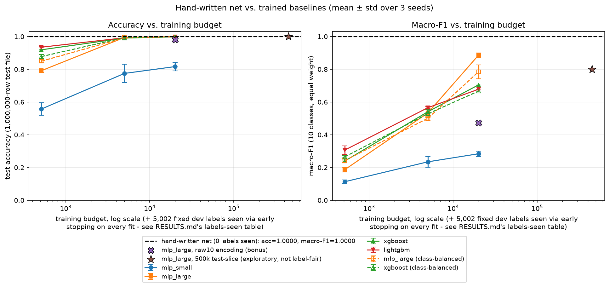

# Results

One-line headline: **a hand-derived, 393-non-zero-parameter network that never saw a single
training label scores 100.0000% accuracy and 1.0000 macro-F1 on all 1,000,000 UCI Poker Hand
test rows - and no trained baseline tested here matches or beats it on any metric, at any
label budget.**

All numbers below are read directly from `results/handnet_test_eval.json` and
`results/baselines.json`, generated by `scripts/eval_test_set.py` and `scripts/run_baselines.py`
respectively. Nothing here is eyeballed or rounded from memory; `scripts/reproduce_all.sh`
regenerates both files (and every other artifact in this document) from scratch in one command.

## Methodology fix: the dev split used to overlap the training budget

An earlier version of this sweep had a real bug: `sample_budget()` drew every label budget
from the full 25,010-row training file, while a 20%, seed-fixed dev split (5,002 rows) of
that same file was used for early stopping and checkpoint selection on every fit. At the full
budget this means a model trained on rows that included the exact rows it was also supposedly
"held out" on for early stopping - the stopping criterion was not actually held out.
`tune_hparams()` was never affected (it already sampled from the non-dev pool only); only the
per-budget sweep rows, plus the raw10 bonus row, were.

Fixed: every budget (and the raw10 bonus row) now samples from the 20,008-row non-dev pool
only, so the top budget is 20,008 rows, not 25,010. The dev split (5,002 rows) is still used
for early stopping on every fit, which means every fit's pipeline actually reads
`budget + 5,002` labels, not just `budget`. The table below reports both: **Budget** is what
the model trains on (gradient steps / tree splits), **Labels seen** is `budget + dev_size`,
the honest total. `results/baselines.json`'s `schema_notes` field states this explicitly.

This was not a cosmetic fix. Comparing against the previously-committed, buggy-methodology
`results/baselines.json` (git commit `1a81376`) at the equivalent full-budget row:

| Metric (full budget) | Old (dev overlapped train) | New (dev genuinely held out) |
|---|---:|---:|
| `xgboost`/`lightgbm` royal_flush recall | 100.00% (both) | 66.67% (both) |
| `mlp_large` four_of_a_kind recall | 44.49% ± 1.64 | 31.59% ± 1.25 |
| `mlp_large` macro-F1 (early-stopped) | 0.9018 ± 0.0103 | 0.8862 ± 0.0145 |

Every one of these moved in the direction of a *less* flattering baseline result, not a more
flattering one - genuinely held-out early stopping is more conservative than early stopping
against data the model also trained on. That is the expected direction for this specific bug
(it can only have inflated apparent generalization, never deflated it), and it widens, not
narrows, the measured gap to the hand-written net. Full writeup in `DECISIONS.md`'s
2026-11-03 "dev-split overlap" entry.

## Results table

| Model | Budget (train) | Labels seen | Non-zero params (weights + biases) | Test accuracy | Macro-F1 | Rare-class recall, classes 6-9 (mean) |
|---|---:|---:|---:|---:|---:|---:|
| **Hand-written net (v1)** | **0** | **0** | **393 (335 + 58)** | **100.0000%** | **1.0000** | **100.00%** |
| mlp_small | 512 | 5,514 | 402 (378 + 24) | 55.70% ± 3.90 | 0.1132 ± 0.0103 | 0.00% ± 0.00 |
| mlp_small | 5,000 | 10,002 | 402 (378 + 24) | 77.47% ± 5.55 | 0.2348 ± 0.0327 | 1.43% ± 1.49 |
| mlp_small | 20,008 | 25,010 | 402 (378 + 24) | 81.64% ± 2.67 | 0.2839 ± 0.0164 | 8.97% ± 9.08 |
| mlp_large | 512 | 5,514 | 111,690 (111,040 + 650) | 79.13% ± 1.09 | 0.1869 ± 0.0147 | 0.01% ± 0.01 |
| mlp_large | 5,000 | 10,002 | 111,690 (111,040 + 650) | 99.44% ± 0.14 | 0.5335 ± 0.0276 | 3.09% ± 1.88 |
| mlp_large | 20,008 | 25,010 | 111,690 (111,040 + 650) | 99.89% ± 0.00 | 0.8862 ± 0.0145 | 66.63% ± 1.58 |
| xgboost | 512 | 5,514 | 6,341 ± 1,878 leaves\* | 91.89% ± 0.04 | 0.2396 ± 0.0119 | 0.00% ± 0.00 |
| xgboost | 5,000 | 10,002 | 19,556 ± 3,418 leaves\* | 99.05% ± 0.18 | 0.5408 ± 0.0132 | 1.34% ± 1.25 |
| xgboost | 20,008 | 25,010 | 35,102 ± 0 leaves\* | 99.84% ± 0.00 | 0.7045 ± 0.0000 | 21.50% ± 0.00 |
| lightgbm | 512 | 5,514 | 11,588 ± 660 leaves\* | 93.48% ± 0.38 | 0.3065 ± 0.0258 | 0.04% ± 0.05 |
| lightgbm | 5,000 | 10,002 | 102,518 ± 21,671 leaves\* | 99.24% ± 0.12 | 0.5654 ± 0.0070 | 2.93% ± 0.10 |
| lightgbm | 20,008 | 25,010 | 107,693 ± 1 leaves\* | 99.85% ± 0.00 | 0.6781 ± 0.0000 | 28.98% ± 0.00 |

Baseline rows are mean ± std (population std) over 3 seeds (0, 1, 2), identical 17-dim
card-order-invariant encoding, `class_weighting="none"`, dev-only hyperparameter tuning,
evaluated once each on the full 1,000,000-row test file. Full per-row data (including per-class
recall, support, and confusion matrices for all 60 rows) is in `results/baselines.json`.

\* Tree-model "non-zero params" is leaf count, the closest tree analog to a learned scalar
weight (`src/poker_handnet/metrics.py:63-87`), not a literal weight-matrix entry; trees have no
bias term, hence 0 in that slot. Leaf count varies by seed at small budgets because early
stopping (50-round patience against the dev split) halts at a different round per seed; it is
nearly identical across all three seeds at budget 20,008 for a structural reason, explained
below.

## Class-balanced variant: does it close the gap?

For `mlp_large` and `xgboost` (the two families given a class-balanced variant - see
`DECISIONS.md` for why those two and not `mlp_small`/`lightgbm`), every budget and seed was
refit with inverse-frequency class weights (`compute_class_weights`,
`scripts/run_baselines.py`), capped at a disclosed 20x max:min ratio. Same encoding, same
budgets, same dev-based early stopping - only the training loss changes (the early-stopping
criterion itself stays unweighted, so both variants pick checkpoints by the same rule).

| Model | Budget | Macro-F1 (unweighted) | Macro-F1 (balanced) | Rare recall 6-9 (unweighted) | Rare recall 6-9 (balanced) |
|---|---:|---:|---:|---:|---:|
| mlp_large | 512 | 0.1869 ± 0.0147 | 0.2425 ± 0.0119 | 0.01% ± 0.01 | 0.08% ± 0.11 |
| mlp_large | 5,000 | 0.5335 ± 0.0276 | 0.5006 ± 0.0131 | 3.09% ± 1.88 | 1.92% ± 1.12 |
| mlp_large | 20,008 | 0.8862 ± 0.0145 | 0.7848 ± 0.0424 | 66.63% ± 1.58 | 59.33% ± 2.18 |
| xgboost | 512 | 0.2396 ± 0.0119 | 0.2652 ± 0.0067 | 0.00% ± 0.00 | 0.05% ± 0.07 |
| xgboost | 5,000 | 0.5408 ± 0.0132 | 0.5282 ± 0.0066 | 1.34% ± 1.25 | 1.36% ± 1.13 |
| xgboost | 20,008 | 0.7045 ± 0.0000 | 0.6665 ± 0.0000 | 21.50% ± 0.00 | 24.60% ± 0.00 |

**Plainly: class-balancing does not close the gap, and it does not reliably even narrow it.**
It helps at the smallest budget (512 labels) - both families improve on both accuracy and
macro-F1 there (e.g. `mlp_large` accuracy 79.13% -> 84.94%; full detail in
`results/baselines.json`). At the full budget it is a net loss on macro-F1 for both families
(`mlp_large` 0.8862 -> 0.7848; `xgboost` 0.7045 -> 0.6665), because reweighting the loss toward
rare classes costs precision/recall on the dominant classes by more than it buys on the rare
ones, and macro-F1 weighs all 10 classes equally including the dominant two.

The rare-class-recall picture at full budget is genuinely mixed once broken out by class
instead of averaged over 6-9, not uniformly better or worse:

| Model | full_house (6) | four_of_a_kind (7) | straight_flush (8) | royal_flush (9) |
|---|---:|---:|---:|---:|
| mlp_large, unweighted | 40.47% ± 1.96 | 31.59% ± 1.25 | 94.44% ± 7.86 | 100.00% ± 0.00 |
| mlp_large, balanced | 32.47% ± 5.26 | 46.52% ± 9.55 | 91.67% ± 11.79 | 66.67% ± 0.00 |
| xgboost, unweighted | 18.47% ± 0.00 | 0.87% ± 0.00 | 0.00% ± 0.00 | 66.67% ± 0.00 |
| xgboost, balanced | 26.97% ± 0.00 | 4.78% ± 0.00 | 0.00% ± 0.00 | 66.67% ± 0.00 |

Balancing gives a real, meaningful lift on `four_of_a_kind` (230 test examples - enough for a
percentage-point change to mean something) for both families, and a real lift on `full_house`
for `xgboost`. It does nothing for `straight_flush` (stuck at 0% for `xgboost` either way) and
appears to *hurt* `mlp_large`'s `royal_flush` recall (100% -> 66.67%). With only 3 royal_flush
and 12 straight_flush rows in the entire 1,000,000-row test file, a single flipped prediction
moves that column by 8-33 percentage points, so these two rightmost columns should not be read
as a precise rate the way the leftmost two can be - they are reported exactly as measured, not
smoothed over. The honest summary: class-balancing is a real, disclosed, bounded fix that
trades overall macro-F1 for a partial, class-size-dependent rare-recall gain, not a fix that
closes the gap to the hand-written net's exact-on-every-class result.

## Full training budget, no early stopping

One row per family, fit on the entire 25,010-row training file (every row, no dev split) for
a fixed iteration count (the rounded 3-seed mean of each family's early-stopped iteration count
at the 20,008-row budget above), touching zero dev labels. This is the "what if every label
were spent on training instead of holding any out" comparison the methodology fix above makes
possible to ask cleanly:

| Model | Labels seen | Fixed iterations | Non-zero params | Test accuracy | Macro-F1 | Rare recall 6-9 (mean) |
|---|---:|---:|---:|---:|---:|---:|
| mlp_small | 25,010 | 861 epochs | 402 | 79.37% | 0.2502 | 2.49% |
| mlp_large | 25,010 | 240 epochs | 111,690 | 99.89% | 0.9084 | 70.30% |
| xgboost | 25,010 | 799 rounds | 36,109 | 99.85% | 0.7389 | 32.61% |
| lightgbm | 25,010 | 592 rounds | 110,447 | 99.86% | 0.7354 | 39.73% |

Single seed (0) each, so no ± std - the point of this row is the fixed-iteration-count design,
not seed variance. Every one of these modestly beats its early-stopped, held-out-dev
counterpart at the same 25,010 labels-seen total (e.g. `mlp_large` macro-F1 0.9084 vs. 0.8862),
which is what should happen when a model trains on the ~20% more rows the dev-held-out rows
above reserve for early stopping instead. It is not a fairer comparison than the dev-held-out
rows above, just a different, equally honest question: "best case with every label spent on
training" rather than "best case with genuine model selection." **`mlp_large` here, not the
early-stopped version above, is the single best baseline result anywhere in this entire
60-row sweep** - see "Brutal honesty" below. Neither version gets anywhere near the
hand-written net's 100.0000% / 1.0000.

## Bonus rows (not part of the fair label-budget comparison)

| Model | Labels seen | Non-zero params | Test accuracy | Macro-F1 | Rare-class recall, classes 6-9 (mean) |
|---|---:|---:|---:|---:|---:|
| mlp_large, raw 10-feature encoding | 25,010 | 109,450 (108,800 + 650) | 98.0422% | 0.4734 | 9.04% |
| mlp_large, 500k test-file slice (exploratory) | 500,000 | 111,690 (111,040 + 650) | 99.9984% | 0.7998 | 50.00% |

The raw10 row's numbers changed from an earlier version of this document (98.604% -> 98.0422%
accuracy, 0.5218 -> 0.4734 macro-F1) because it is subject to the same methodology fix above -
it now also trains on the 20,008-row non-dev pool rather than all 25,010 rows. The 500k-slice
row's numbers are unchanged: its train/early-stop/eval split is entirely internal to the test
file (see below) and was never affected by the training-file dev-split bug.

The second bonus row trains on 90% of one randomly-chosen half of the 1,000,000-row *test*
file, early-stops on the other 10% of that same half, and evaluates on the other half entirely
- disjoint from both, but still drawn from the test file, so it uses test-file labels for
training by construction. It is not a fair comparison to anything else in this document; it
exists only to show where a trained baseline converges given far more labels than the entire
25,010-row training file provides. Exact rare-class counts in each of the three disjoint
pieces (`results/baselines.json`'s `exploratory_500k_test_slice.rare_class_split_detail`):

| | straight_flush | royal_flush |
|---|---:|---:|
| Internal fit (trained on) | 4 | 1 |
| Internal dev (early-stop signal only) | 1 | 1 |
| Evaluated half (`big_eval_idx`) | 7 | 1 |

The model saw 4 real straight_flush and 1 real royal_flush example during training (plus one
more of each used only for early-stopping signal) and still scored 0% recall on both in the
evaluated half - not "zero examples anywhere," but zero generalization from the few it did see
to the ones it didn't. Its confusion matrix (`results/baselines.json`) shows where those
predictions went: all 7 missed straight_flush hands and the 1 missed royal_flush hand were
predicted as plain `flush` - the structurally adjacent class that straight_flush and
royal_flush are both special cases of.

## Accuracy and macro-F1 vs. training budget



Generated by `scripts/plot_results.py` directly from the two JSON files above. The
hand-written net's horizontal line is not an extrapolation or a fit - it is the single
measured point at 0 labels seen, drawn across the full label-budget range for visual
comparison. The class-balanced variant is drawn as a dashed, hollow-marker line next to its
unweighted counterpart; the `full_budget_no_early_stop` rows are not plotted (better read as
the table above) but remain in `results/baselines.json`.

## Brutal honesty: does any baseline match or beat the hand-written net?

**No, not on any of the three reported metrics, at any tested budget, anywhere in this sweep.**
The closest competitor in the entire 60-row sweep is `mlp_large`, trained on the entire
25,010-row training file with **no early stopping** (fixed at 240 epochs, a count chosen from
the early-stopped runs' own typical iteration count - see "Full training budget, no early
stopping" above): 99.89% accuracy (vs. 100.0000%), macro-F1 0.9084 (vs. 1.0000), and 70.30%
rare-class recall, classes 6-9 mean (vs. 100.00%). That is a real, substantial gap on every
axis, not a rounding difference - and it is the *best* baseline result anywhere in this sweep,
better even than the same architecture with genuine held-out early stopping (0.8862 macro-F1),
because it gets to train on the ~5,000 rows the early-stopped version reserves for dev instead.
Every other family/budget/variant combination - balanced or not, early-stopped or not - is
further behind.

A more subtle point worth stating plainly: **accuracy is the most misleading column in this
table.** `xgboost` and `lightgbm` at the full budget both score 99.84-99.86% accuracy -
visually close to the hand-written net's 100% - while their best macro-F1 (0.7389 and 0.7354,
both from the no-early-stop rows) and rare-class recall (32.61% and 39.73%) are nowhere close.
Accuracy is dominated by the two overwhelmingly common classes (`nothing` and `one_pair` are
92.4% of the test set between them), so a model can miss entire rare classes outright and still
post a superficially impressive accuracy number. Macro-F1 and rare-class recall are the metrics
that actually separate "learned the game" from "learned the common case," and on both of those
every baseline - weighted, unweighted, early-stopped, or not - falls far short.

### The rare-class story is more interesting, and more honest, than "rare = hard"

Per-class recall for classes 6-9 at the full 20,008-budget / 25,010-labels-seen row (mean ±
std over 3 seeds, unweighted, early-stopped):

| Model | full_house (6) | four_of_a_kind (7) | straight_flush (8) | royal_flush (9) |
|---|---:|---:|---:|---:|
| mlp_large | 40.47% ± 1.96 | 31.59% ± 1.25 | 94.44% ± 7.86 | 100.00% ± 0.00 |
| xgboost | 18.47% ± 0.00 | 0.87% ± 0.00 | 0.00% ± 0.00 | 66.67% ± 0.00 |
| lightgbm | 19.24% ± 0.00 | 30.00% ± 0.00 | 0.00% ± 0.00 | 66.67% ± 0.00 |

`mlp_large` is the only baseline that gets `straight_flush` right most of the time (94.44%);
`xgboost` and `lightgbm` both score **0% on straight_flush**, a class with 12 test examples -
roughly four times more common than royal_flush (3 examples), yet harder for the tree models to
separate. All three families beat 66% on `royal_flush` despite it being the single rarest
class in the dataset (an expected ~0.04 examples in a 25,010-row training sample, from the
exhaustive 2,598,960-hand distribution), and `mlp_large` gets all 3 of the test file's
royal_flush rows exactly right. This is not "rarer is harder": royal flush is a sharp, highly
separable pattern (single suit, consecutive-high ranks) that these models apparently generalize
to from nearby straight/flush examples even with near-zero direct training exposure, while
straight_flush sits in a part of feature space `xgboost` and `lightgbm`'s split search
evidently never carves out cleanly. The hand-written net gets all four classes exactly right,
every time, by construction - it has no equivalent of this unpredictability, which is the
actual structural advantage being measured here, not just a bigger number.

(`xgboost` and `lightgbm`'s royal_flush recall here is 66.67%, not the 100% an earlier,
methodology-buggy version of this document reported - see the methodology-fix section above.
That earlier 100% was inflated by the dev-overlap bug, not a real result.)

### Encoding matters for trained baselines too, not just the hand-written net

The `mlp_large`/raw10 bonus row uses the same model, same labels-seen total (25,010), and
*fewer* parameters (109,450 vs. 111,690, since the raw encoding has 10 input features instead
of 17) as the matched `encoded17` row, yet scores markedly worse on every metric: 98.0422%
accuracy (vs. 99.89%), 0.4734 macro-F1 (vs. 0.8862), 9.04% mean rare-class recall (vs. 66.63%).
The card-order-invariant 17-dim encoding (integrity ruling 4) is not a trick that only helps the
hand-written net's hand-derived logic - it materially helps gradient-based learning too, by
making the relevant structure (rank multiplicities, suit counts) explicit instead of leaving
the model to discover order-invariance from 10 raw positional features on its own.

### More labels than the whole training file still does not close the gap

The 500k-test-slice bonus row trains `mlp_large` on 500,000 labels - about 20x the entire
25,010-row training file - and still scores 0% recall on both `straight_flush` and
`royal_flush` in that evaluation half (7 and 1 examples respectively; see the bonus-rows
section above for the exact three-way split). This is not a contradiction of the royal_flush
result above: it is a different, smaller, randomly-drawn 500,000-row half of the test file, and
with only 1 royal_flush example in that half, a single miss is a 0% recall by arithmetic, not
evidence the model forgot what it learned at 25,010 labels. The honest reading is the same
either way: a trained model's performance on the rarest classes is sensitive to exactly which
few examples happen to land in its training and evaluation splits, in a way the hand-written
net - which is correct on every one of the 2,598,960 possible hands by construction, not by
having seen the right sample - simply is not.

## Methodological note: tree-model seed-invariance at the full training budget

`xgboost` and `lightgbm` report **bit-identical accuracy, macro-F1, and per-class recall**
across all three seeds at budget 20,008 (visible in the results table above: std = 0.00 on
every evaluation metric). This was checked and is not a bug. `sample_budget()`
(`scripts/run_baselines.py`) draws a seed-dependent *permutation* of row indices, but at
budget = pool size (20,008 = the entire non-dev pool) that permutation covers every pool row
regardless of seed, so all three seeds train on the identical dataset. Neither `fit_xgb` nor
`fit_lgb` sets `subsample`/`colsample_bytree` (xgboost) or `bagging_fraction`/`feature_fraction`
(lightgbm); all default to 1.0, so there is no row or column subsampling at any budget. With an
identical dataset and no stochastic subsampling, both libraries' deterministic greedy/histogram
split search produces identical trees regardless of the `seed` parameter. (`lightgbm`'s leaf
count does differ by exactly 1 leaf in one of the three seeds - 107,694 vs. 107,692 vs.
107,694 - a tiny exception to that invariance, not further diagnosed here since it has zero
effect on accuracy, macro-F1, or any per-class recall, all of which stay bit-identical.) The
MLPs do *not* show this invariance at the same budget (weight initialization and minibatch
shuffling still vary by seed), which corroborates the explanation rather than pointing to a
shared data bug.

## Phase 2: the one allowed revision was not exercised

Per the spec, Phase 1's frozen weights could be revised once after inspecting errors on a
labeled dev split. `scripts/audit_labels.py` read all 25,010 training-file rows (the first
label read anywhere in this project, strictly after the weight-freezing commit `263f105`) and
compared the frozen net's predictions, an independent oracle's predictions, and UCI's own
labels against each other: **0 mismatches in all three pairwise comparisons.** The revision
was not exercised. **v1 == v2** - the net evaluated above is exactly the zero-label-seen net
frozen before any label was read (sha256 `708d63be05b53b2bb421405af5c6ad2901d8ec69689b299f14eb7e3b49c5d78a`,
`weights/handnet_v1.npz`). Full detail in `DECISIONS.md`'s "Phase 2 label-definition audit"
entry and `results/label_audit.json`.

## Label-definition audit finding

Before relying on UCI's label column at all, both the frozen net and an independently-written
oracle were validated against the exhaustive combinatorial domain: all 2,598,960 possible
5-card hands from a standard 52-card deck, zero labels read, class distribution matching UCI's
published aggregate table exactly. The subsequent training-file audit (above) confirmed no
convention mismatch: UCI's labels use the ace-low straight (A-2-3-4-5 counts as a straight),
ace-high straight, and royal-flush-as-a-straight-flush-subset conventions this project assumed
from the dataset documentation, with no wraparound straights and no other surprises.

## Reproducing these numbers

```
scripts/reproduce_all.sh
```

regenerates every number and figure in this document from scratch: the frozen weights (from
poker rules only, reading no label), the label audit, the final test-set evaluation, the full
baseline sweep, the weight-heatmap figures, this document's plot, and the browser demo - then
runs the full test suite. See that script for the exact command sequence and expected wall
time.

## Caveats

- The baseline sweep's hyperparameter search (`tune_hparams` in `scripts/run_baselines.py`) is
  a small, bounded grid - 3 learning rates for each MLP size, 2 depths x 3 learning rates for
  each tree library - selected once on a 5,000-row dev-adjacent sample and then locked in for
  every budget, seed, and class-weighting variant. It is a fair, disclosed comparison, not an
  exhaustive hyperparameter search; a wider search could plausibly move any baseline's numbers
  somewhat, in either direction.
- "Labels seen" (budget + dev_size) counts every label a fit's pipeline actually reads,
  including the 5,002 dev rows used only for early-stopping signal, never a gradient step or
  tree split. The `full_budget_no_early_stop` rows are the one exception (dev_size=0 by
  design - they touch no dev labels at all).
- `early_stopping_rounds=50` for both tree libraries means their effective tree count - and
  therefore their leaf-count "non-zero params" figure - is itself a learned quantity, not fixed
  in advance the way the MLP architectures and the hand-written net's architecture are.
- The hand-written net's 393 non-zero parameters and the baselines' parameter counts are not
  directly comparable measures of "model capacity" in a strict information-theoretic sense -
  they are reported because the spec asks for them, and because the contrast (393 vs. 35,102+
  for the closest-accuracy competitors) is itself part of the honest story, not because
  non-zero parameter count alone determines what a model can learn.
- This project's rare-class results (especially the 500k-test-slice row and the royal_flush /
  straight_flush columns generally) are sensitive to the specific random split drawn - 3 and 12
  test examples respectively leave very little room for a "rate" to mean what it usually means.
  They are reported with that sensitivity made explicit above rather than re-rolled until a
  cleaner-looking number appeared.
- The class-balanced variant (`mlp_large`, `xgboost` only - see `DECISIONS.md`) is a disclosed,
  bounded (20x max:min ratio) inverse-frequency reweighting, not a tuned or validated-optimal
  one; a different cap or a per-class-tuned scheme could plausibly do better or worse.
- See `README.md` for the "this is just a compiled rule set, not learning" critique, addressed
  directly rather than avoided.
